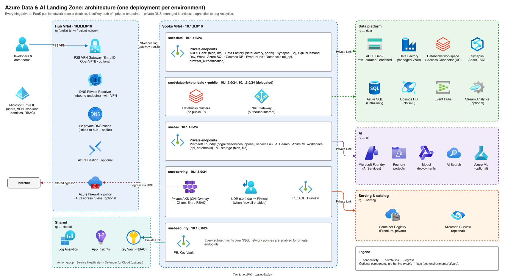

# Azure Data & AI Landing Zone (Terraform)

[](https://github.com/MedGhassen/Enterprise-Azure-Data-AI-Landing-Zone/actions/workflows/ci.yml)
[](LICENSE)


A modular, **private-by-default** Azure landing zone for data and AI workloads, built with Terraform
and aligned with the [Cloud Adoption Framework](https://learn.microsoft.com/azure/cloud-adoption-framework/).
It deploys a hub-spoke network, a medallion data lake, data engineering services, Microsoft Foundry and
AI Search, and a private AKS serving tier, with management groups, policy and RBAC handled by a separate
tenant-level stack.

> **Disclaimer:** this is a community project. It is **not** an official Microsoft product and is not
> affiliated with or endorsed by Microsoft. For Microsoft's reference implementations see
> [Azure Landing Zones](https://aka.ms/alz) and [Azure Verified Modules](https://aka.ms/avm).
> Review the code, security settings and costs before deploying to production.

## Contents

- [What you get](#what-you-get)
- [Architecture](#architecture)
- [Repository layout](#repository-layout)
- [Quick start](#quick-start)
- [Post-deployment steps](#post-deployment-steps)
- [Configuration](#configuration)
- [Security model](#security-model)
- [Cost](#cost)
- [CI/CD](#cicd)
- [Development and testing](#development-and-testing)
- [Limitations and roadmap](#limitations-and-roadmap)

## What you get

| Area | Components |
| ---- | ---------- |
| **Governance** (`platform/`) | Management groups (Platform, Landing Zones, Sandbox + children) with deterministic IDs, subscription placement, allowed-locations and tag policies, ISO 27001 / NIS2 / custom compliance initiatives, Data Engineer / Data Scientist / ML Engineer custom roles |
| **Networking** | Hub VNet (Azure Firewall + policy, P2S VPN with Entra ID, DNS Private Resolver, Bastion), spoke VNet with NSG per subnet, AKS egress through the firewall (UDR), NAT Gateway for Databricks, 22 private DNS zones, VNet flow logs + Traffic Analytics |
| **Foundation** | Log Analytics, Application Insights, action group + Service Health alert, Key Vault (RBAC, private), optional Defender for Cloud |
| **Data** | ADLS Gen2 (raw / curated / enriched + unity, synapse), Data Factory (managed VNet), Databricks (VNet injection, Private Link, Unity Catalog access connector), Synapse (Spark, serverless SQL, optional dedicated pool), Azure SQL, Cosmos DB, Event Hubs, optional Stream Analytics |
| **AI** | Microsoft Foundry (AI Services account, projects, model deployments), Azure AI Search with a keyless Foundry connection, optional Azure Machine Learning workspace |
| **Serving** | Private AKS (Entra ID + Azure RBAC, CNI Overlay + Cilium, workload identity, auto-upgrades), Premium ACR, optional Microsoft Purview |
| **Operations** | Offline tests, TFLint, Trivy, terraform-docs, deployment pipelines for GitHub Actions and Azure DevOps (OIDC, plan/approve/apply per environment) |

Every optional service sits behind an `enable_*` flag, so you can start small (see [`examples/minimal.tfvars`](examples/minimal.tfvars)).

## Architecture



More diagrams (all editable draw.io files, see [docs/diagrams](docs/diagrams)):
[network topology](docs/diagrams/network.svg) ·
[governance](docs/diagrams/governance.svg) ·
[data & AI flow](docs/diagrams/data-flow.svg) ·
[identity & access](docs/diagrams/identity.svg) ·
[CI/CD & state](docs/diagrams/cicd.svg)

Key design decisions:

- **Two stacks.** `platform/` holds tenant-level governance and is deployed once. The repository root is
  the landing zone and is deployed once **per environment** (dev, staging, prod), ideally into a dedicated
  subscription per environment.
- **Self-contained environments.** Each environment gets its own hub and spoke. Connecting to a central
  connectivity hub is on the [roadmap](#limitations-and-roadmap).
- **No public endpoints, no keys.** PaaS services disable public network access and local/key auth;
  traffic uses private endpoints and services authenticate with managed identities.

## Repository layout

```
.
├── main.tf / variables.tf / outputs.tf / locals.tf / providers.tf   # landing zone (per environment)
├── environments/            # dev / staging / prod profiles
├── examples/                # minimal and full profiles
├── platform/                # tenant-level governance stack (deploy once)
├── modules/
│   ├── governance/          # management groups, policy, custom roles (used by platform/)
│   ├── networking/          # hub-spoke, firewall, VPN, DNS, NAT, flow logs
│   ├── monitoring/          # Log Analytics, App Insights, alerts
│   ├── security/            # Key Vault, Defender for Cloud
│   ├── data_lake/           # ADLS Gen2
│   ├── data_factory/        # Azure Data Factory
│   ├── databricks/          # Azure Databricks + Unity Catalog access connector
│   ├── synapse/             # Azure Synapse Analytics
│   ├── databases/           # Azure SQL, Cosmos DB
│   ├── streaming/           # Event Hubs, Stream Analytics
│   ├── ai/                  # Microsoft Foundry, AI Search, Azure ML
│   └── serving/             # AKS, ACR, Purview
├── tests/                   # offline terraform tests (mocked providers)
├── pipelines/               # deployment pipelines (GitHub Actions, Azure DevOps)
├── scripts/                 # state bootstrap, docs and diagram export
└── docs/                    # diagrams and generated input/output reference
```

Each module has a README with its inputs and outputs; the root reference is in [docs/reference.md](docs/reference.md).

## Quick start

### Prerequisites

- Terraform **>= 1.9** and Azure CLI (`az login`)
- Permissions: **Owner** (or Contributor + User Access Administrator) on the target subscription; for
  `platform/` also **Management Group Contributor** and **Resource Policy Contributor** on the parent
  management group
- Resource providers registered and quota for the SKUs you enable (AKS vCPUs, AI model capacity, ...)

### 1. Bootstrap the state backend

```bash
./scripts/bootstrap-state.sh            # optional: -l <region> -g <rg> -s <storage-account>
```

The script creates a storage account with shared keys disabled, versioning and soft delete, and grants
you *Storage Blob Data Contributor*. It prints the `terraform init` commands to use.

### 2. Deploy the platform stack (once per tenant)

```bash
cd platform
cp platform.tfvars.example platform.tfvars      # git-ignored; edit prefix, locations, subscriptions
terraform init -backend-config=... -backend-config="key=platform.tfstate"
terraform apply -var-file=platform.tfvars
```

Skip this step if your organisation already manages management groups and policy (for example with ALZ).

### 3. Deploy a landing zone environment

```bash
cd ..
terraform init -backend-config=... -backend-config="key=data-ai-landing-zone-dev.tfstate"
export ARM_SUBSCRIPTION_ID=<dev-subscription-id>
terraform plan  -var-file=environments/dev.tfvars -out=tfplan
terraform apply tfplan
```

Edit `owner_email`, `cost_center` and the feature flags in the tfvars file first. **Do not commit**
subscription IDs or backend values: pass them with `-backend-config`, environment variables or CI secrets.

### 4. Connect

Everything is private. Reach the services through the P2S VPN (`enable_vpn_gateway = true`, Azure VPN
Client with Entra ID), Azure Bastion (`enable_bastion = true`) or your own connectivity to the hub.

## Post-deployment steps

Some steps cannot (or should not) be automated from outside the private network:

1. **Data Factory managed private endpoints:** approve the pending connections on the data lake storage
   account (*Networking → Private endpoint connections*).
2. **Databricks Unity Catalog:** in the Databricks account console, assign the workspace to a metastore
   and create a storage credential with the `databricks_access_connector_id` output and
   `abfss://unity@<storage_account_name>.dfs.core.windows.net/`.
3. **Synapse managed private endpoints:** from Synapse Studio (over VPN/Bastion) create managed private
   endpoints to the lake for Spark/pipelines and approve them on the storage account. Synapse's identity
   already has *Storage Blob Data Contributor*.
4. **AKS access:** `az aks get-credentials` + `kubelogin`, from a network that resolves the private API
   server. Grant access with `aks_admin_group_object_ids` or Azure RBAC roles.
5. **Models:** check model availability and quota in your region; adjust `model_deployments`.
6. **SQL / Synapse administrators:** by default the deploying identity is the Entra admin. In shared
   environments set `entra_admin_object_id` to an Entra group.

## Configuration

### Environment profiles

| Setting | dev | staging | prod |
| ------- | --- | ------- | ---- |
| Firewall (AKS egress via UDR) | off | on | on (threat intel: Deny) |
| P2S VPN + DNS resolver | on | off | off |
| Bastion | off | off | on |
| VNet flow logs | off | on | on |
| Log retention | 30 days (5 GB/day cap) | 90 days | 365 days |
| Key Vault purge protection | off | on | on |
| Resource locks | off | off | on |
| Data lake replication | LRS | ZRS | GZRS |
| Synapse dedicated SQL pool | off | off | on |
| Cosmos DB | serverless | autoscale | autoscale |
| AI Search | basic | standard | standard ×2 replicas |
| AKS | Free tier, 1–2 + 0–2 nodes | Standard, 2–3 + 1–3 | Standard, 3–5 + 2–10 |
| Purview | off | off | on |

### Main feature flags

| Variable | Default | Description |
| -------- | ------- | ----------- |
| `enable_firewall` | `true` | Azure Firewall + policy; AKS egress via UDR |
| `enable_vpn_gateway` | `false` | P2S VPN (Entra ID) + DNS Private Resolver |
| `enable_bastion` | `false` | Azure Bastion |
| `enable_flow_logs` | `false` | VNet flow logs + Traffic Analytics |
| `enable_data_factory` / `enable_databricks` / `enable_synapse` | `true` | Data engineering services |
| `enable_sql_database` / `enable_cosmos_db` / `enable_event_hubs` | `true` | Data stores and streaming |
| `enable_stream_analytics` | `false` | Stream Analytics job |
| `enable_foundry` / `enable_ai_search` / `enable_ml_workspace` | `true` | AI services |
| `enable_aks` / `enable_purview` | `true` / `false` | Serving and catalog |
| `enable_defender` | `false` | Defender plans (subscription-wide: one stack per subscription) |
| `enable_resource_locks` | `false` | `CanNotDelete` locks on all workload resource groups |

All inputs: [docs/reference.md](docs/reference.md).

### Naming and tagging

- Pattern: `{resource_prefix}-{environment}-{region}-{type}-{instance}`, for example `dataai-prod-weu-hub-vnet-001`.
  Resource groups: `rg-{prefix}-{env}-{region}-{network|shared|data|ai|serving}-{instance}`.
- Globally unique names (storage, Key Vault, ACR, SQL, Synapse, Cosmos DB, Event Hubs, Foundry, Search, ADF)
  also carry a 4-character `unique_suffix`, generated once and kept in state (or set it yourself).
- Tags: `project`, `environment`, `managed_by`, `cost_center`, `owner` + `additional_tags`. The platform
  stack requires tags on resource groups and makes resources inherit them.

## Security model

- **Network:** no public network access on PaaS; private endpoints with `private_dns_zone_group`; NSG on every
  spoke subnet; AKS is a private cluster with egress through the firewall; Databricks uses secure cluster
  connectivity and Private Link (front-end and back-end).
- **Identity:** Entra-only authentication for SQL, Synapse, Cosmos DB, Event Hubs, AI Search, Foundry and
  storage (shared keys disabled). Service-to-service access uses managed identities and least-privilege
  RBAC (see the [identity diagram](docs/diagrams/identity.svg)). AKS local accounts are disabled.
- **Data protection:** TLS 1.2+, infrastructure (double) encryption on storage, blob/container soft delete,
  Key Vault purge protection, Cosmos DB continuous backup, SQL TDE and auditing.
- **Monitoring:** diagnostic settings to Log Analytics for every service, Service Health alerts, optional
  Defender for Cloud.
- **Supply chain:** pinned providers (lock file for linux/darwin/windows), GitHub Actions pinned to commit
  SHAs, Dependabot, Trivy in CI.

Report vulnerabilities as described in [SECURITY.md](SECURITY.md).

## Cost

Even idle, a landing zone has fixed costs (firewall, gateways, private endpoints, AKS nodes, AI Search).
Rough, list-price **order-of-magnitude** estimates for the provided profiles, before workload consumption
(data processing, tokens, storage, log ingestion):

| Profile | Rough fixed cost / month | Main drivers |
| ------- | ------------------------ | ------------ |
| `examples/minimal.tfvars` | ~$300–500 | ~10 private endpoints, AI Search basic, ACR Premium, Log Analytics |
| `environments/dev.tfvars` | ~$1,000–1,500 | VPN gateway + DNS resolver, AKS node, ~20 private endpoints, AI Search basic |
| `environments/prod.tfvars` | ~$4,000–6,000+ | Firewall, Synapse DW100c (pause it when idle), AKS nodes + SLA, AI Search ×2, Purview, Bastion |

Prices vary by region, agreement and over time; check with the
[Azure pricing calculator](https://azure.microsoft.com/pricing/calculator/) or Infracost before deploying.
Disable what you don't need, and pause the Synapse dedicated pool and AKS when idle.

## CI/CD

- **CI** ([`.github/workflows/ci.yml`](.github/workflows/ci.yml)) runs on every pull request with no Azure
  credentials: `terraform fmt`, `validate`, `test` (mocked providers), TFLint, Trivy, terraform-docs and shellcheck.
- **Deployment pipelines** (copy into your fork):
  - GitHub Actions: [`pipelines/github/`](pipelines/github). Pull requests plan every environment and post the plan as a comment.
    Pushes to `main` promote dev → staging → prod; each apply runs behind a GitHub environment with reviewers
    and applies the exact plan artifact that was reviewed. OIDC only (no client secrets).
  - Azure DevOps: [`pipelines/azure-devops/`](pipelines/azure-devops), with workload identity federation
    service connections and ADO environments for approvals.

See the [CI/CD diagram](docs/diagrams/cicd.svg) and the comments at the top of each pipeline file for setup.

## Development and testing

```bash
terraform fmt -recursive
terraform init -backend=false && terraform validate && terraform test
(cd platform && terraform init -backend=false && terraform validate && terraform test)
tflint --init && tflint --recursive --config "$PWD/.tflint.hcl"
trivy config .
./scripts/generate-docs.sh       # module READMEs + docs/reference.md
./scripts/export-diagrams.sh     # draw.io -> SVG
```

The tests in [`tests/`](tests) and [`platform/tests/`](platform/tests) use Terraform's mock providers, so
they need no Azure access. They cover the dev/prod/minimal profiles, name-length limits and input validation.
See [CONTRIBUTING.md](CONTRIBUTING.md) for conventions.

## Limitations and roadmap

**Status:** `v0.1.0`. The configuration passes `terraform validate`, the offline test suites, TFLint and
Trivy, and every profile in `environments/` and `examples/` produces a clean `terraform plan` against a
real subscription. A full `apply` is not part of CI; deploy to a sandbox subscription first and please
open an issue if something fails.

Known limitations / planned work:

- Bring-your-own hub (peer the spoke to an existing connectivity hub and central private DNS zones)
- Customer-managed keys (CMK) as an opt-in for storage, Cosmos DB, SQL and AKS
- Unity Catalog metastore, Synapse managed private endpoints and Event Hubs capture are not managed by
  Terraform (see [post-deployment steps](#post-deployment-steps))
- Single region per deployment; no paired-region DR automation
- Workload rules on the firewall are limited to the AKS baseline; add your own rule collection groups
  through the `firewall_policy_id` output

## Contributing

Contributions are welcome. Please read [CONTRIBUTING.md](CONTRIBUTING.md) and the
[Code of Conduct](CODE_OF_CONDUCT.md). Changes are tracked in [CHANGELOG.md](CHANGELOG.md).

## License

[MIT](LICENSE)
