# Azure Data & AI Landing Zone

Production-grade, enterprise-ready Azure Data & AI Landing Zone built with Terraform. The infrastructure is modular, secure-by-default, and follows [Azure Cloud Adoption Framework (CAF)](https://learn.microsoft.com/en-us/azure/cloud-adoption-framework/) best practices.

## Architecture Overview

The landing zone implements a **hub-spoke** network topology with:

- **Foundation:** Governance (management groups, Azure Policy, RBAC), Networking (hub VNet, spoke VNet, Azure Firewall, Private DNS zones, optional P2S VPN Gateway with Entra ID auth, DNS Private Resolver, Bastion, Network Watcher / NSG flow logs), Monitoring (Log Analytics, Application Insights), and Security (Key Vault, Microsoft Defender for Cloud).
- **Data layer:** ADLS Gen2 (medallion: raw / curated / enriched), Azure Data Factory (managed VNet), Azure Databricks (VNet-injected, Unity Catalog), Azure Synapse Analytics (SQL + Spark pools), Azure SQL Database, Cosmos DB, Event Hubs, Stream Analytics.
- **AI/ML:** Azure ML Workspace, Azure AI Foundry (Hub + Projects), Azure OpenAI Service, Cognitive Services, AI Search.
- **Serving:** AKS (private cluster), Azure Container Registry, optional Microsoft Purview.

All PaaS services are accessed via **Private Endpoints** only (zero public internet exposure). Managed identities are used throughout; secrets are stored in Key Vault.

### Architecture diagram

```mermaid
flowchart TB
    subgraph Governance
        MG[Management Groups]
        Policy[Azure Policy]
        RBAC[RBAC]
    end

    subgraph Hub[Hub VNet]
        FW[Azure Firewall]
        VPN[P2S VPN Gateway]
        DNS[Private DNS Resolver]
        subgraph Subnets
            SnetSec[Security Subnet]
            SnetData[Data Subnet]
            SnetAI[AI Subnet]
            SnetServing[Serving Subnet]
        end
    end

    subgraph Foundation
        LA[Log Analytics]
        AI[Application Insights]
        KV[Key Vault]
        Defender[Defender for Cloud]
    end

    subgraph DataLayer[Data Layer]
        ADLS[ADLS Gen2<br/>raw/curated/enriched]
        ADF[Data Factory]
        DB[Databricks]
        Synapse[Synapse]
        SQL[Azure SQL]
        Cosmos[Cosmos DB]
        EH[Event Hubs]
    end

    subgraph AIML[AI/ML]
        AML[Azure ML]
        AIFoundry[AI Foundry]
        OpenAI[OpenAI]
        Cognitive[Cognitive Services]
        Search[AI Search]
    end

    subgraph Serving
        AKS[AKS]
        ACR[Container Registry]
        Purview[Purview]
    end

    MG --> Policy
    MG --> RBAC
    Hub --> FW
    Hub --> VPN
    SnetSec --> KV
    SnetData --> ADLS
    SnetData --> ADF
    SnetData --> DB
    SnetData --> Synapse
    SnetData --> SQL
    SnetData --> Cosmos
    SnetData --> EH
    SnetAI --> AML
    SnetAI --> AIFoundry
    SnetAI --> OpenAI
    SnetAI --> Cognitive
    SnetAI --> Search
    SnetServing --> AKS
    SnetServing --> ACR
    SnetServing --> Purview
    ADLS --> ADF
    ADLS --> Synapse
    KV --> AML
    LA --> Defender
```



## Management group hierarchy

When `create_management_group_hierarchy` is enabled, the governance module creates a CAF-aligned structure under the tenant root:

- **Tenant Root** has three direct children: **Platform**, **Landing Zones**, **Sandbox** (siblings).
- **Platform** (central IT shared services) contains: **Management** (Log Analytics, Defender, Sentinel), **Connectivity** (Hub VNet, Firewall, DNS), and optionally **Identity** (hybrid AD). Set `create_identity_management_group = true` to create the Identity child.
- **Landing Zones** (workload subscriptions) contains: **Data & AI — Dev**, **Data & AI — Staging**, **Data & AI — Prod**.
- **Sandbox** contains one child **Sandbox** management group for the sandbox subscription.

Subscription associations are created when the corresponding subscription ID variables are set: `subscription_id_connectivity`, `subscription_id_management`, `subscription_id_identity`, `subscription_id_dataai_dev`, `subscription_id_dataai_staging`, `subscription_id_dataai_prod`, `subscription_id_sandbox`. Leave empty to skip. The legacy `subscription_id` variable associates a single subscription with the Landing Zones parent.

```
Tenant Root
├── Platform (Management, Connectivity, Identity*)
├── Landing Zones (Data & AI — Dev, Staging, Prod)
└── Sandbox (Sandbox)
* Identity child created when create_identity_management_group = true
```

## Compliance policies

Regulatory compliance initiatives can be assigned at a management group when the corresponding enable flag is `true`:

| Flag / variable | Description |
|-----------------|-------------|
| `enable_iso27001` | Assigns the built-in **ISO 27001:2013** Regulatory Compliance initiative. Set to `true` in prod (e.g. in `environments/prod.tfvars`). |
| `enable_nis2` | Assigns the **NIS2** initiative. Requires `nis2_initiative_id` (custom or partner policy set definition ID); Azure has no built-in NIS2 initiative. |
| `compliance_policy_scope_mg` | Target management group: `landing_zones` (default), `platform`, or `sandbox`. |
| `compliance_policy_parameters_iso27001` / `compliance_policy_parameters_nis2` | Optional JSON string of parameters for the initiative. |
| `compliance_policy_assignments` | List of additional initiatives: `enable`, `initiative_display_name` or `policy_set_definition_id`, `assignment_scope`, `parameters`, `assignment_name`. |

Only assignments whose enable parameter is `true` are created. Use environment-specific tfvars to enable ISO 27001 in production and leave it off in dev/staging if desired.

## VPN Gateway (Point-to-Site)

When `enable_vpn_gateway` is `true`, the networking module deploys:

- **P2S VPN Gateway** with **Entra ID (Azure AD) authentication** and OpenVPN protocol in the hub VNet.
- **Azure DNS Private Resolver** with an inbound endpoint in the hub, so VPN clients can resolve all private DNS zones (private endpoints).
- Hub VNet DNS settings are updated to point at the resolver IP, which the VPN Gateway propagates to connected clients automatically.

| Variable | Description |
|----------|-------------|
| `enable_vpn_gateway` | Enable the VPN Gateway and DNS Private Resolver (default `false`). |
| `vpn_client_address_pool` | CIDR for P2S client addresses (default `172.16.0.0/24`, must not overlap with hub/spoke). |

The VPN Gateway is enabled by default in `environments/dev.tfvars` for developer access and disabled in staging/prod.

## Prerequisites

- **Terraform** >= 1.5.0
- **Azure CLI** (for local auth: `az login`)
- **Azure subscription** with sufficient quotas
- **Permissions:** Contributor (or equivalent) on the subscription or target resource groups; User Access Administrator for RBAC assignments

### Provider versions

- `hashicorp/azurerm` ~> 3.85  
- `hashicorp/azuread` ~> 2.47  
- `azure/azapi` ~> 1.12  
- `databricks/databricks` ~> 1.35  
- `hashicorp/random` ~> 3.5  

## State backend

Terraform state is stored in Azure Storage with **Entra ID (Azure AD) authentication** — shared-key access is disabled. The backend is configured in `providers.tf` with `use_azuread_auth = true`.

**Bootstrap** the backend before the first run using the provided script:

```bash
# One-time: create resource group, storage account (shared-key disabled), container,
# and assign Storage Blob Data Contributor to the current user.
./scripts/bootstrap-state.sh

# Override defaults with flags:
./scripts/bootstrap-state.sh -l northeurope -g my-rg -s mystorage01
```

The script outputs a `terraform init -backend-config=...` command. Run it to configure the backend. **Do not commit** backend config values, subscription IDs, or secrets — use `-backend-config`, `-var`, environment variables, or CI/CD secrets.

The script auto-generates a storage account name from your subscription ID, disables shared-key access, and assigns the `Storage Blob Data Contributor` RBAC role. For CI/CD pipelines, assign the same role to each pipeline service principal or managed identity.

## Naming and tagging

- **Naming:** `{resource_prefix}-{environment}-{region_short}-{resource_type}-{instance}`  
  Example: `dataai-dev-weu-hub-vnet-001`, `dataai-prod-weu-fw-001`  
  Resource groups use the form `rg-{resource_prefix}-{environment}-{region_short}-{instance}` (e.g. `rg-dataai-dev-weu-001`).
- **Tags:** `project`, `environment`, `managed_by`, `cost_center`, `owner` (from `variables.tf` / `terraform.tfvars`).

## Deployment

### Local (dev)

```bash
# After bootstrap: init with backend config (use values from bootstrap script output)
terraform init -backend-config="resource_group_name=rg-terraform-state" \
  -backend-config="storage_account_name=<from-bootstrap>" \
  -backend-config="container_name=tfstate" \
  -backend-config="key=data-ai-landing-zone.tfstate"

terraform plan -var-file=environments/dev.tfvars
terraform apply -var-file=environments/dev.tfvars
```

### Per environment

- **Dev:** `terraform apply -var-file=environments/dev.tfvars`
- **Staging:** `terraform apply -var-file=environments/staging.tfvars`
- **Prod:** `terraform apply -var-file=environments/prod.tfvars`

Environments differ by SKU sizes, feature flags (e.g. Purview and Bastion in prod, VPN Gateway in dev), compliance policies (e.g. ISO 27001 enabled in prod), and retention. Key variables you may override: `subscription_id` (single-sub association with Landing Zones), `subscription_id_connectivity` / `subscription_id_management` / `subscription_id_dataai_*` / `subscription_id_sandbox` (multi-sub association with child MGs), `enable_bastion`, `enable_vpn_gateway`, `vpn_client_address_pool`, `enable_purview`, `enable_iso27001`, `enable_nis2`, `nis2_initiative_id`, and backend settings (`backend_*`).

## CI/CD

- **GitHub Actions:** Copy `pipelines/github-actions.yml` to `.github/workflows/terraform.yml`.  
  - On PR: `fmt -check`, `validate`, `plan` (with PR comment).  
  - On push to `main`: `plan` then `apply` (use environment approval for production).  
  - Uses OIDC for Azure auth. Set secrets: `AZURE_CLIENT_ID`, `AZURE_TENANT_ID`, `AZURE_SUBSCRIPTION_ID` (and federated credential); `TF_STATE_RESOURCE_GROUP`, `TF_STATE_STORAGE_ACCOUNT`, `TF_STATE_CONTAINER` for backend config.

- **Azure DevOps:** `pipelines/azure-pipelines.yml`  
  - Validate → Plan → Apply (with environment approval).  
  - Set `ARM_SERVICE_CONNECTION` and pipeline variables: `BACKEND_RESOURCE_GROUP`, `BACKEND_STORAGE_ACCOUNT`, `BACKEND_CONTAINER`.

## Security

- **Do not commit:** Subscription IDs, backend config values (`resource_group_name`, `storage_account_name`, etc.), API keys, or secrets. Use `-backend-config`, `-var`, environment variables, or CI/CD secrets. The `.gitignore` excludes common sensitive files.
- **Zero public endpoints:** All relevant PaaS services use Private Endpoints; public access is disabled.
- **Managed identities:** Used for Data Factory, Synapse, Databricks, ML, AKS, etc.
- **Key Vault:** Premium, RBAC-only, soft-delete and purge protection; no public access.
- **Encryption:** TLS 1.2 minimum; encryption at rest (TDE for SQL, default for storage/cosmos).
- **Least privilege:** RBAC scoped to resource groups; custom roles for Data Engineers, Data Scientists, ML Engineers (see governance module).

## Project structure

```
.
├── main.tf                      # Root module: wires all child modules together
├── variables.tf                 # Input variables and feature flags
├── outputs.tf                   # Root-level outputs (re-exported from modules)
├── locals.tf                    # Naming conventions, region short codes, common tags
├── providers.tf                 # Provider versions, azurerm backend (Entra ID auth)
├── terraform.tfvars             # Default variable values
├── environments/
│   ├── dev.tfvars               # Dev overrides (VPN enabled, Bastion off)
│   ├── staging.tfvars           # Staging overrides
│   └── prod.tfvars              # Prod overrides (Bastion, Purview, ISO 27001 on)
├── modules/
│   ├── governance/              # Management groups, Azure Policy, RBAC
│   ├── networking/              # Hub-spoke VNets, Firewall, VPN, DNS, NSGs
│   │   ├── main.tf              # Hub/spoke VNets, subnets, peering, Firewall, DNS zones
│   │   └── vpn.tf               # P2S VPN Gateway, DNS Private Resolver
│   ├── monitoring/              # Log Analytics, Application Insights, action groups
│   ├── security/                # Key Vault, Microsoft Defender for Cloud
│   ├── data_lake/               # ADLS Gen2, medallion filesystems, private endpoints
│   ├── data_factory/            # ADF, managed VNet, managed private endpoints
│   ├── databricks/              # Workspace (VNet-injected), Unity Catalog
│   ├── synapse/                 # Workspace, SQL pool, Spark pool
│   ├── databases/               # Azure SQL, Cosmos DB
│   ├── streaming/               # Event Hubs, Stream Analytics
│   ├── ai_ml/                   # ML workspace, AI Foundry, OpenAI, Cognitive, AI Search
│   └── serving/                 # AKS, ACR, optional Purview
├── pipelines/
│   ├── github-actions.yml       # GitHub Actions CI/CD (OIDC auth)
│   └── azure-pipelines.yml      # Azure DevOps CI/CD (service connection)
└── scripts/
    └── bootstrap-state.sh       # Bootstrap Terraform state backend (Entra ID)
```

## Module layout

| Module        | Purpose |
|---------------|--------|
| `governance`  | Management group hierarchy (Platform, Landing Zones, Sandbox + children), Azure Policy, compliance initiatives (ISO 27001, NIS2), custom RBAC |
| `networking`  | Hub-spoke VNets, VNet peering, Azure Firewall, optional P2S VPN Gateway (Entra ID auth), DNS Private Resolver, Bastion, private DNS zones, NSGs, Network Watcher / NSG flow logs |
| `monitoring`  | Log Analytics, Application Insights, action groups |
| `security`    | Key Vault, Microsoft Defender for Cloud |
| `data_lake`   | ADLS Gen2, medallion filesystems, lifecycle, private endpoints |
| `data_factory`| ADF, managed VNet, managed private endpoints |
| `databricks`  | Workspace (VNet-injected), Unity Catalog, private endpoint |
| `synapse`     | Workspace, SQL pool, Spark pool, managed PE to ADLS |
| `databases`   | Azure SQL, Cosmos DB |
| `streaming`   | Event Hubs, Stream Analytics, capture to ADLS |
| `ai_ml`       | ML workspace, AI Foundry Hub/Projects, OpenAI, Cognitive, AI Search |
| `serving`     | AKS, ACR, optional Purview |

Each module has `main.tf`, `variables.tf`, and `outputs.tf` and is independently testable.

## Outputs

Root outputs include: resource group name/id, VNet and subnet IDs, storage account ID and DFS endpoint, Databricks workspace URL, Synapse SQL/Spark/dev endpoints, ML workspace ID, AI Foundry Hub ID, OpenAI endpoint, AKS FQDN and kubeconfig (sensitive), Key Vault URI, Log Analytics workspace ID, Data Factory ID, Event Hubs namespace, Cosmos DB and SQL server endpoints.

The `networking` module also exposes: VPN Gateway ID and public IP, DNS Private Resolver inbound IP (all `null` when VPN is disabled). The `governance` module exposes management group IDs (platform, landing_zones, sandbox, and child MGs: management, connectivity, identity, data_ai_dev/staging/prod, sandbox_child), custom role definition IDs, and policy assignment IDs.

## Cost

Costs vary by environment (SKU sizes, retention, Purview/Bastion). Use the environment-specific `.tfvars` to size down in dev/staging (e.g. smaller SQL/Spark/AKS SKUs, shorter retention).

## Status

This landing zone has been validated in **dev and test** environments. Production deployments should follow your organization's change management and security review processes. Before production use, review and customize compliance policies, SKU sizes, and retention settings for your requirements.

## Contributing

Contributions are welcome. To contribute:

1. **Fork** the repository and create a feature branch (`git checkout -b feature/your-feature`).
2. **Follow** existing patterns: run `terraform fmt -recursive` and `terraform validate` before committing.
3. **Test** changes in a dev environment before submitting.
4. **Open a PR** with a clear description of the change and reference any related issues.

For significant changes (e.g. new modules or compliance scope), open an issue first to discuss.

## License

This project is licensed under the [MIT License](LICENSE).
