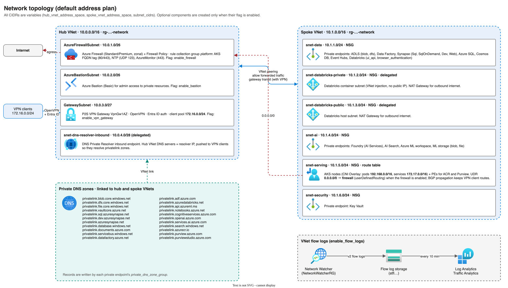
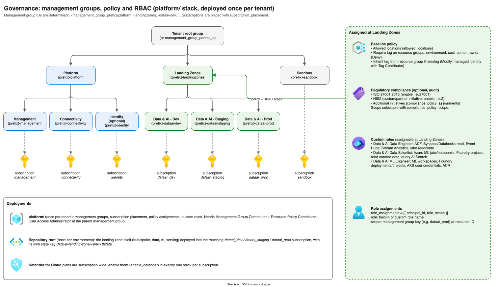
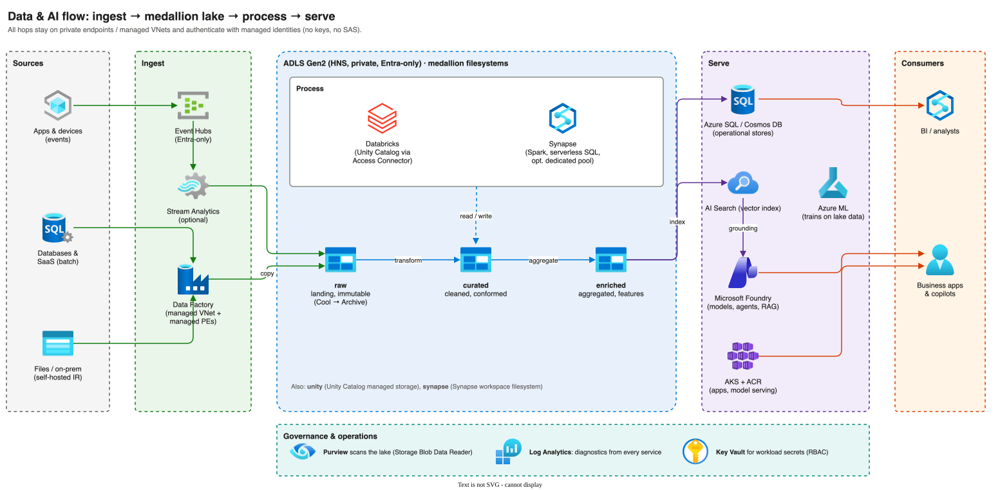
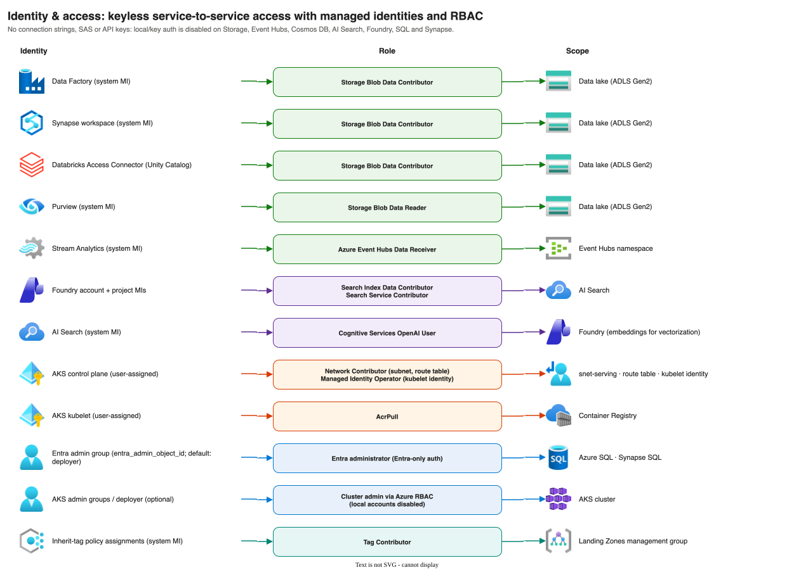
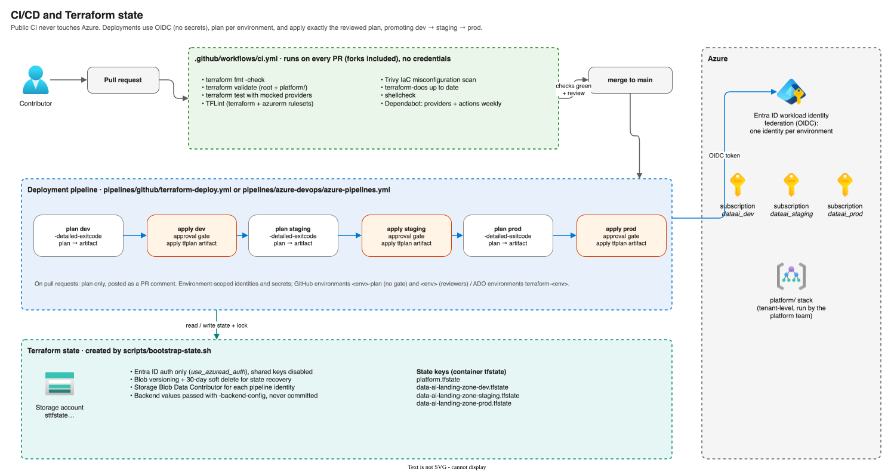

# Diagrams

The architecture diagrams are maintained in [draw.io](https://www.drawio.com) and use the official
Azure icon set bundled with draw.io (`img/lib/azure2`).

| Diagram | Source | Shows |
| ------- | ------ | ----- |
|  | [architecture.drawio](architecture.drawio) | Hub/spoke, subnets, private endpoints and services per resource group |
|  | [network.drawio](network.drawio) | Address plan, subnets, firewall routing, VPN, private DNS zones, flow logs |
|  | [governance.drawio](governance.drawio) | Management groups, subscription placement, policies, custom roles |
|  | [data-flow.drawio](data-flow.drawio) | Ingest, medallion lake, processing, serving and AI |
|  | [identity.drawio](identity.drawio) | Managed identities and RBAC role assignments |
|  | [cicd.drawio](cicd.drawio) | CI checks, deployment pipeline, OIDC and Terraform state |

## Editing

1. Open the `.drawio` file in draw.io desktop, [app.diagrams.net](https://app.diagrams.net) or the
   VS Code *Draw.io Integration* extension.
2. Save, then regenerate the SVGs: `./scripts/export-diagrams.sh`
   (the SVGs embed the diagram and icons, so they also render on GitHub and can be re-opened in draw.io).
3. Commit both the `.drawio` and the `.svg` files.

Keep the diagrams in sync with the code: update them in the same pull request as architecture changes.
